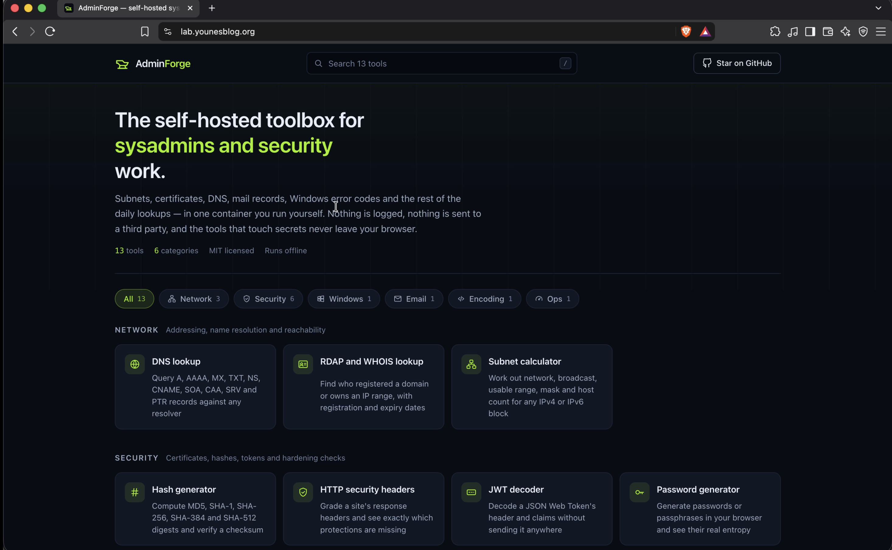

# AdminForge AWS Container Deployment

AdminForge is a DevOps portfolio project demonstrating how to containerise an application and deploy it to AWS ECS Fargate using Terraform and GitHub Actions.

The project focuses on Infrastructure as Code, secure CI/CD, automated deployment and repeatable infrastructure teardown.

## Architecture


**Request flow:** Cloudflare DNS → Route 53 → Application Load Balancer → ECS Fargate.

The application runs in private subnets across two Availability Zones. Terraform provisions the infrastructure, while GitHub Actions builds, publishes and deploys versioned container images.

## Demo




## What I Built

- **AWS infrastructure:** VPC, public and private subnets across two Availability Zones, Internet Gateway, NAT Gateways, route tables and security groups.
- **Container platform:** Amazon ECS Fargate running a containerised ASP.NET application without public IP addresses on the tasks.
- **Load balancing and HTTPS:** Application Load Balancer, target group, AWS Certificate Manager and Route 53 DNS records.
- **Infrastructure as Code:** Reusable Terraform modules for networking, ECS, load balancing, DNS and related resources.
- **Containerisation:** Custom Dockerfile using .NET 10, with the application running as a non-root user on port `8080`.
- **CI/CD:** GitHub Actions workflows for building and pushing images, deploying infrastructure and destroying the application environment.
- **Secure authentication:** GitHub OIDC with separate AWS IAM roles for image publishing and Terraform operations.

## CI/CD Workflow

Three GitHub Actions workflows manage the deployment lifecycle.

### 1. Build and Push

Triggered by changes pushed to `main`.

- Authenticates to AWS using GitHub OIDC.
- Builds the Docker image.
- Tags the image with the Git commit SHA.
- Pushes the image to Amazon ECR.

### 2. Terraform Deploy

Runs after a successful image build, or through manual workflow dispatch.

- Checks out the relevant commit.
- Validates the Terraform configuration.
- Uses the corresponding image tag.
- Plans and applies the infrastructure.
- Waits for ECS deployment and checks the application health endpoint.

### 3. Destroy

Manually triggered to remove the application infrastructure when it is no longer needed.

The bootstrap resources, ECR repository and Terraform state are managed separately so the application can be redeployed without rebuilding the entire CI/CD foundation.

## Security and Engineering Decisions

- **OIDC instead of access keys:** GitHub Actions assumes AWS IAM roles without storing long-lived AWS credentials.
- **Separate IAM roles:** Image publishing and Terraform operations use different roles.
- **Private ECS tasks:** Application tasks have no public IP addresses and accept application traffic only from the load balancer.
- **Immutable image tags:** Git commit SHAs identify specific image versions, avoiding reliance on `latest`.
- **Remote Terraform state:** State is stored in Amazon S3, separate from the application infrastructure.
- **Non-root container:** The application runs as an unprivileged user.
- **Automated health checks:** The deployment verifies the application through `/healthz`.

## Repository Structure

```text
.
├── .github/
│   └── workflows/
│       ├── build-and-push.yml
│       ├── terraform.yml
│       └── destroy.yml
├── app/
│   └── AdminForge/
│       └── Dockerfile
├── docs/
│   ├── architecture.png
│   ├── adminforge-online.png
│   ├── adminforge-local.png
│   ├── build-and-push-workflow.png
│   ├── terraform-workflow.png
│   ├── destroy-workflow.png
│   └── recording.gif
└── terraform/
    ├── bootstrap/
    ├── modules/
    ├── backend.tf
    ├── main.tf
    ├── variables.tf
    └── outputs.tf

## Setup and Deployment

### Prerequisites

- An AWS account with appropriate permissions.
- AWS CLI, Terraform, Docker and Git installed.
- A GitHub repository with Actions enabled.
- An existing ECR repository named `my-adminforge-app` in `eu-west-2`.
- An S3 bucket configured for Terraform remote state.
- A Route 53 hosted zone with the required DNS delegation.
- A domain and certificate configuration matching the Terraform variables.

### 1. Clone the Repository

```bash
git clone <repository-url>
cd <repository-directory>
```

### 2. Configure Bootstrap Resources

The bootstrap configuration creates the GitHub OIDC provider, IAM roles and policies used by the workflows.

Review the configuration before applying it:

```bash
terraform -chdir=terraform/bootstrap init
terraform -chdir=terraform/bootstrap fmt -check
terraform -chdir=terraform/bootstrap validate
terraform -chdir=terraform/bootstrap plan
```

Apply only after reviewing the plan:

```bash
terraform -chdir=terraform/bootstrap apply
```

The bootstrap configuration is separate from the application infrastructure and should be retained if you want to redeploy the project.

### 3. Configure GitHub Secrets

Add the following repository secrets under **Settings → Secrets and variables → Actions**:

| Secret | Value |
|---|---|
| `bnp_AWS_ROLE_ARN` | ARN of the ECR publishing IAM role |
| `tf_AWS_ROLE_ARN` | ARN of the Terraform IAM role |

The IAM trust policy must match the GitHub repository and the permitted branch or workflow identity.

### 4. Configure Terraform

Review the Terraform variables and backend configuration before deploying.

Ensure the backend points to the intended S3 bucket and state key, and that the required AWS region, domain and application image settings are correct.

Validate the application configuration:

```bash
terraform -chdir=terraform init
terraform -chdir=terraform fmt -check
terraform -chdir=terraform validate
terraform -chdir=terraform plan
```

### 5. Deploy

Push the application and Terraform changes to `main` to trigger the build workflow. After a successful build, the deployment workflow provisions the infrastructure and deploys the corresponding image.

Alternatively, use the supported manual workflow dispatch options in GitHub Actions.

### 6. Validate

The application health endpoint is:

```text
/healthz
```

A successful response should return HTTP `200`.

Check the GitHub Actions logs, ECS service events, task status and ALB target health to troubleshoot deployment failures.

### 7. Destroy

Use the **Destroy** workflow when the application infrastructure is no longer required. Review the workflow and Terraform plan before confirming teardown.

The bootstrap resources, ECR repository, Terraform state bucket and hosted zone are managed separately and are not intended to be removed by the application teardown workflow.
